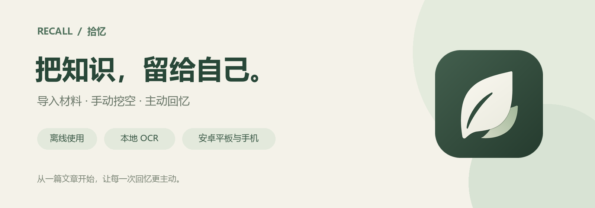
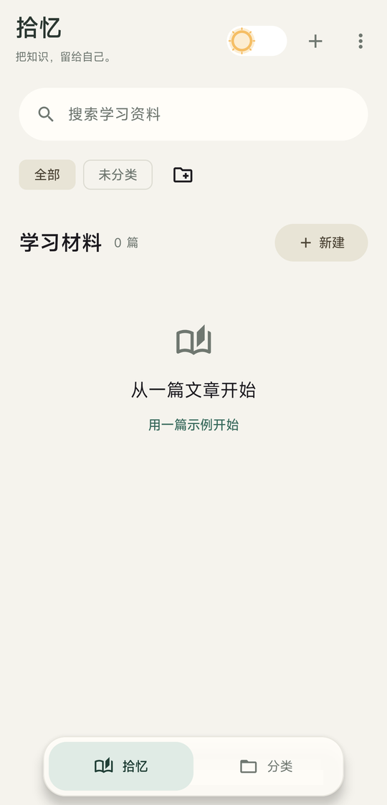
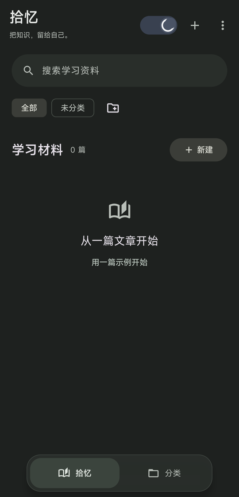
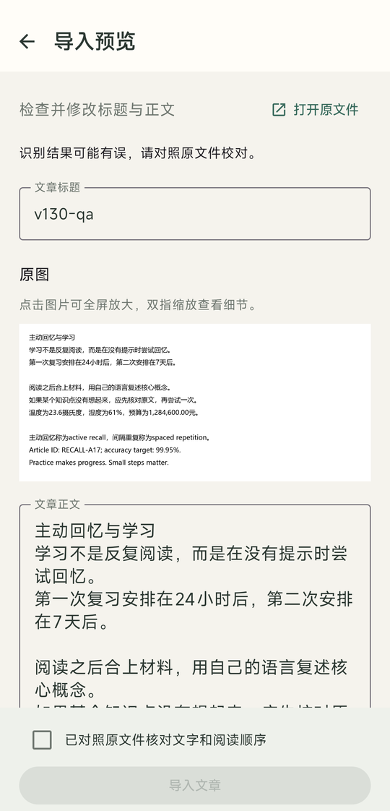
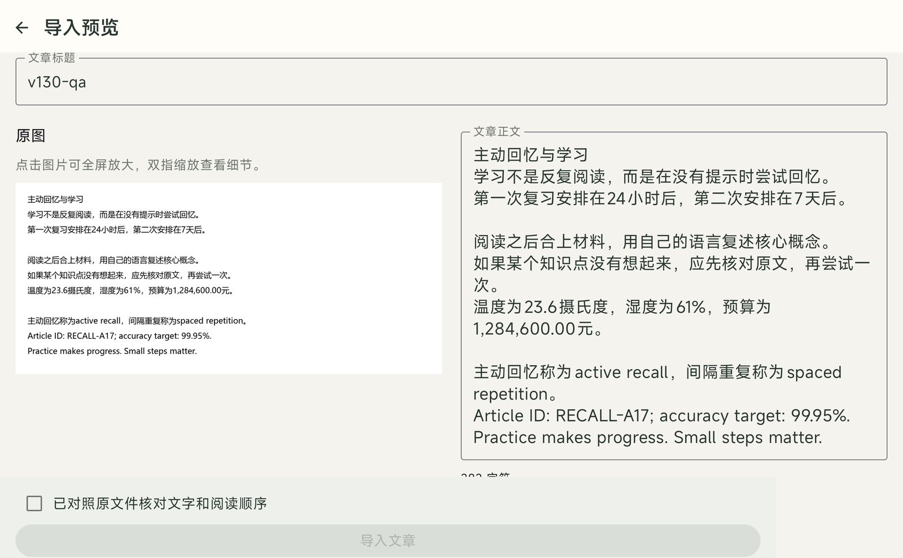

<p align="center">
  
</p>

<h1 align="center">拾忆 · Recall</h1>

<p align="center">
  一款面向安卓平板和手机的离线背诵应用。<br>
  把文章变成自己的练习，用划选留下空白，用回忆补全知识。
</p>

<p align="center">
  <strong>Android 8.0+</strong> &nbsp; · &nbsp; <strong>ARM64</strong> &nbsp; · &nbsp; <strong>v1.3.4</strong> &nbsp; · &nbsp; <strong>本地 OCR</strong>
</p>

<p align="center">
  <a href="#界面预览">界面预览</a> &nbsp; / &nbsp;
  <a href="#开始使用">开始使用</a> &nbsp; / &nbsp;
  <a href="docs/USAGE.md">使用指南</a> &nbsp; / &nbsp;
  <a href="#开发与构建">开发与构建</a>
</p>

## 让材料成为练习

- **自己决定挖空位置**：手指划过文字即可标记；双击红字取消整处挖空，支持撤销和重做。
- **先回忆，再看答案**：点击空白查看单处答案，约 5 秒后自动隐藏；也可一次显示全部答案。
- **导入已有学习材料**：支持 Markdown、文字 PDF、扫描 PDF 和 PNG 图片，预览校对后再保存。
- **在本机完成识别**：内置离线 OCR 模型，图片与扫描件无需上传；资料保存在本机。
- **整理自己的资料库**：搜索文章、文件夹分类、长按拖动归类，并通过 ZIP 导出和恢复备份。
- **适应不同阅读场景**：深浅主题一键切换，支持字号调整、手机竖屏及平板横竖屏布局。

## 界面预览

<p align="center">暖白与墨绿，给文字留出空间。</p>

<table>
  <tr>
    <th align="center">浅色资料库</th>
    <th align="center">深色资料库</th>
    <th align="center">图片导入与校对</th>
  </tr>
  <tr>
    <td width="33%"></td>
    <td width="33%"></td>
    <td width="33%"></td>
  </tr>
</table>

**平板宽屏 · 原图与正文并排校对**



<sub>以上为 v1.3.4 实际运行截图，已裁去系统状态栏；导入页使用测试样本。样本中的数字和 accuracy target 为识别测试文本，不代表产品准确率承诺。</sub>

## 开始使用

1. **准备材料**：点击「＋新建」输入标题和正文，或用右上角「＋」选择文件导入。
2. **划出重点**：进入「标记」模式，划过需要背诵的文字，点右上角「完成」。从文字以外的空白处拖动也能滚动页面。
3. **尝试回忆**：在背诵页补全被遮住的内容，点击空白核对答案，重复练习。

标题独立编辑，不能为空；编辑草稿与正式文章分开保存。详细手势、正文修改、分类及备份操作见 [使用指南](docs/USAGE.md)。

### 支持的导入格式

| 格式 | 处理方式 | 预览体验 |
| --- | --- | --- |
| Markdown | 保留源文本，支持 UTF-8、带 BOM 的 UTF-16；GB18030 可确认后重试 | 编辑标题与正文 |
| 文字 PDF | 按页提取原生文字 | 编辑标题与正文 |
| 扫描 PDF | 使用本机 OCR 识别，按原页序合并 | 校对正文，可打开原文件 |
| PNG 图片 | 使用本机 OCR 识别 | 手机上下排列，平板宽屏左右对照；点图可缩放 |

图片和扫描件的识别结果可能有错字、漏字或阅读顺序差异，需要人工校对。确认导入后才会创建文章，取消不会保存半成品。

<details>
<summary>查看文件大小与使用边界</summary>

- Markdown 最大 8 MB；PDF 和 PNG 最大 32 MB。
- PDF 最多 30 页；PNG 最多 2400 万像素，超过 800 万像素会缩采样。
- 正文最多 100 万字符；Markdown 暂不渲染图片、链接和表格等富文本。
- 旋转屏幕或短暂切后台可保留识别任务与预览；进程被系统结束后，未确认的导入需要重新选择文件。
- 当前安装包面向 ARM64 安卓平板和手机，最低 Android 8.0。

</details>

### 资料与备份

资料保存在本机，请定期从「更多」菜单导出 ZIP 备份。恢复备份会创建新集合，不覆盖已有资料。

**卸载应用会删除本机资料；使用同签名安装包覆盖更新可保留资料。** 备份不包含草稿、主题和字号设置，请先保存正在编辑的文章。

## 开发与构建

项目使用 **Kotlin / Java + Jetpack Compose + Room**，通过 **PDFBox Android、ONNX Runtime 和 OpenCV** 在本机处理文档与图片。

| 环境 | 版本 |
| --- | --- |
| JDK | 17 |
| Android SDK / Build Tools | 36 |
| Gradle / Android Gradle Plugin | 9.1.0 / 9.0.1 |
| Compose BOM / Room | 2026.02.00 / 2.8.4 |

使用 Android Studio 打开项目，配置 Android SDK 路径（`local.properties`）并等待 Gradle 同步。

**签名配置：** 当前 Debug 和 Release 构建均引用本机 `signing/recall-personal.jks` 与 `signing/signing.properties`，这些私密文件不在仓库中。项目维护者须在本机恢复原签名；其他开发者需配置自己的签名后构建。自行签名的安装包无法直接覆盖原签名版本。

```powershell
# 确保 JAVA_HOME 指向 JDK 17，且已配置 SDK 与本机签名
.\gradlew.bat :app:testDebugUnitTest :app:assembleDebug :app:assembleRelease :app:lintDebug
```

macOS / Linux 使用 `./gradlew` 执行对应任务。首次构建需要联网下载依赖；应用内文档识别可离线运行。

<details>
<summary>项目结构与验证记录</summary>

```text
app/src/main/
├── java/com/hh/recall/
│   ├── core/        # 挖空范围、编辑历史、答案显隐
│   ├── data/        # Room、草稿、ZIP 备份
│   ├── importing/   # 文本提取与离线 OCR
│   └── ui/          # Compose 页面与阅读交互
├── assets/          # OCR 模型、第三方许可证
└── res/             # 图标与 Android 资源
design/app-icon/     # 图标 SVG 源图与 PNG
docs/               # 使用指南与展示图片
scripts/            # 构建辅助、设备验收与资料保留核验
```

1.3.4 已完成 36 项 JVM 单测、Debug / AndroidTest / Release 构建及 Lint；设备专项覆盖主题切换、搜索、导入、大小字号和布局适配。验证范围、已知边界及历史记录见 [VALIDATION.md](VALIDATION.md)。

开发交接信息见 [HANDOFF.md](HANDOFF.md)。设备测试会覆盖安装测试版本，执行前请阅读项目的资料保护和签名要求。

</details>

## 最近更新

| 版本 | 主要变化 |
| --- | --- |
| **1.3.4** | 首页日月主题开关、搜索聚焦反馈、导入读取动效 |
| **1.3.3** | 双叶矢量应用图标及系统主题图标适配 |
| **1.3.2** | 精简导入提示，调整预览排版与间距 |
| **1.3.1** | PNG 同页对照校对、手机和平板分类网格优化 |
| **1.3.0** | Markdown / PDF / PNG 导入及离线 OCR |

本仓库提供源码；本机生成的 APK 和源码压缩包位于 `dist/`，不纳入 Git 版本管理。

## 致谢与第三方声明

感谢 PaddleOCR、RapidOCR、ONNX Runtime、OpenCV、PDFBox Android，以及 Uiverse 组件作者的工作。具体版本、参考来源、模型说明与许可证见 [THIRD_PARTY.md](THIRD_PARTY.md)；相关许可文件随源码和 APK 一同保留。
